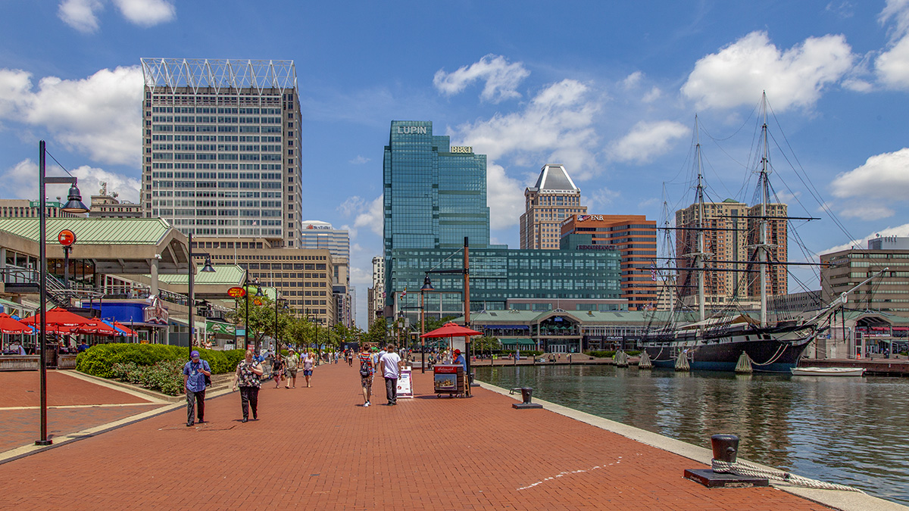

## Abstract

This paper explores how geography shapes the legacy
of redlining, the systemic mortgage lending bias against minority
us neighborhoods. On average, redlined neighborhoods lag behind
adjacent, less-discriminated areas in home values, income, and racial
composition. Yet, redlined neighborhoods near parks and water fare
better. To help understand convergence, we inventory waterfront
renovations, apply machine learning to historical imagery to track
tree canopy changes, and instrument such changes exploiting tree
replacements due to geographic variation in tree plagues and
susceptible species. Findings suggest that enhancing waterfronts
and increasing tree canopy can mitigate the long-lasting effects of
institutionalized discrimination. 

##
**The Baltimore Inner Harbor example**

*From his home near the Inner Harbor, C.J. Welsh has watched with interest the new building that has transformed the downtown area and the renovation that has made his neighborhood one of the most expensive and sought in the city. [...] "I used to live in a 12,000$ row house in South Baltimore", said Welsh. "Now I live in  a 40,000$ town house on Federal Hill, and I haven't moved".* (The Washington Post, 1984)

::: {layout-ncol=2}
{#fig-before}

{#fig-after}
:::
## 
## Suggested citation 

```bibtex
@misc{minano2023,
  author = {Alba Miñano-Mañero},
  title = {When are D-graded neighborhoods not degraded? Greening the legacy of redlining},
  year = {2023}
}
```