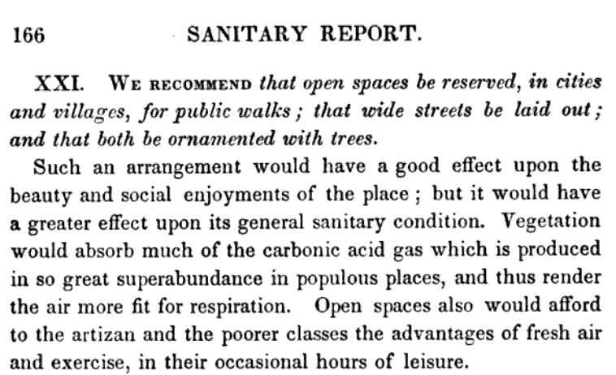

## Abstract

This project studies how the improvements in the urban physical space (the park movement) implemented between 1850 and 1950 contributed to the urban mortality transition in the City of New York. Although these landscapes modifications were motivated by incorrect science (such as reducing miasmas), they may have had positive long-term effects.

##

**Massachusetts Sanitary Commissioners (1850). *Report of a general plan for the promotion of public and personal health.***

##