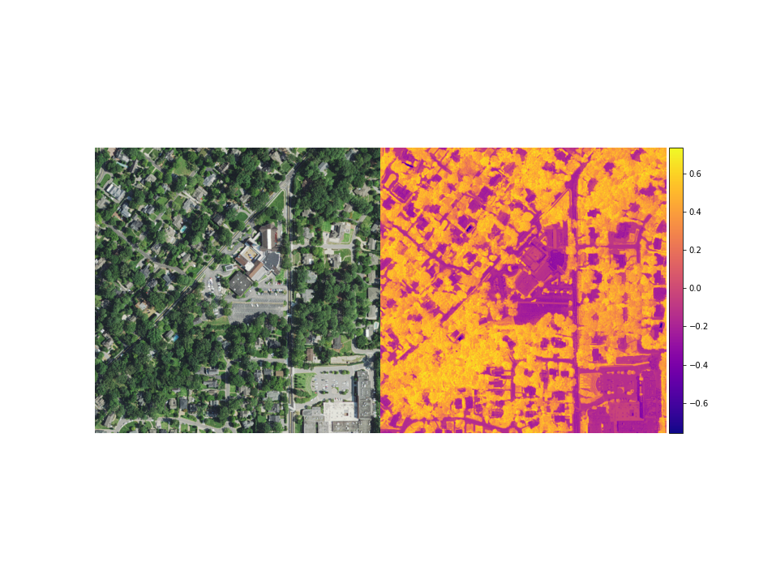

## Abstract

This paper develops a fully-automated workflow for constructing panels of tree canopy from high-resolution multispectral imagery with limited near-infrared (NIR) training data. The workflow utilizes the tree-pixel detection algorithm developed by Yang et al. (2009) and Bosch (2020) on a large set of U.S. urban areas but modifies it by creating automatic ground-truth masks through various visual graphics techniques that leverage modern high-resolution NIR data. Using a subset of cities that represent the different U.S. climate regions, I quantify the effectiveness of the workflow by implementing the algorithm. The comparison shows that my workflow is the option that leads to better results in terms of accuracy, recall, and precision.

##

**Mapping between near-infrared light and tree canopy**
{#census_training}

##

## Suggested Citation

```bibtex
@misc{minanogreen2023,
  author = {Alba Miñano-Mañero},
  title = {Trees of green: constructing panels of tree canopy from aerial imagery},
  year = {2023}
}
```